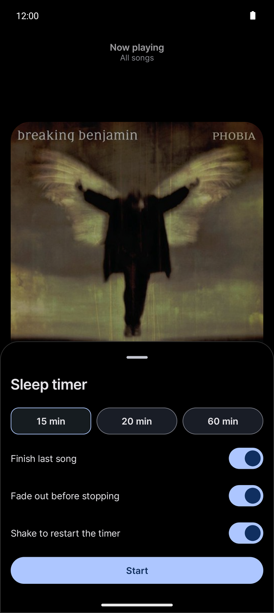
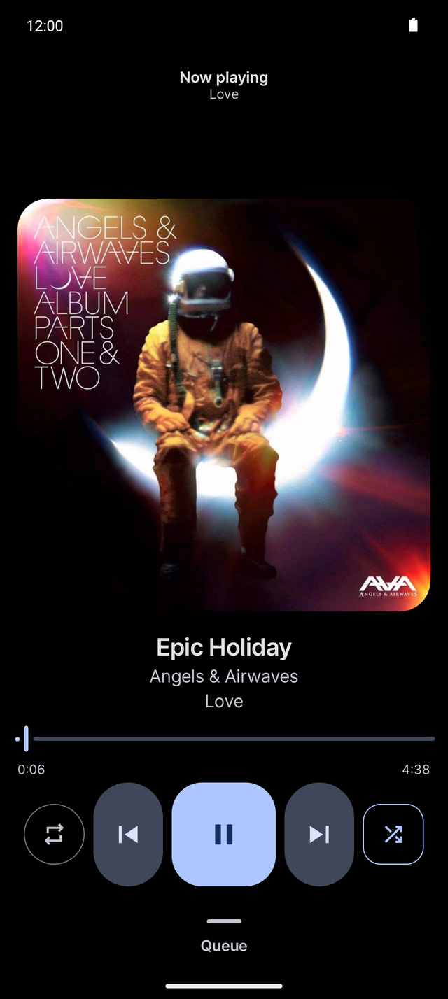
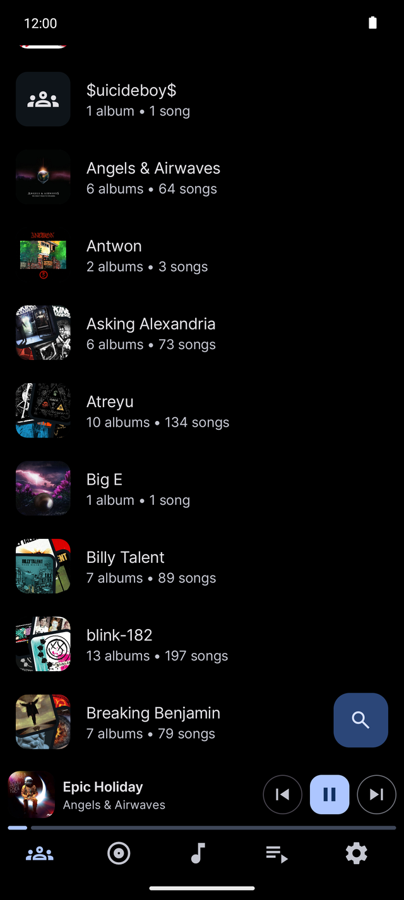
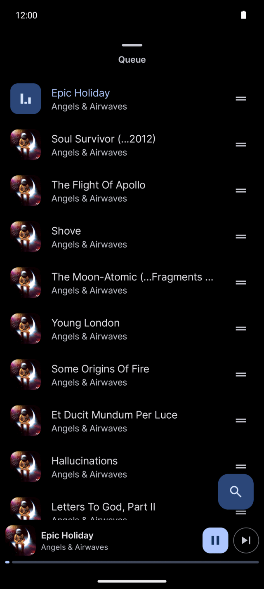
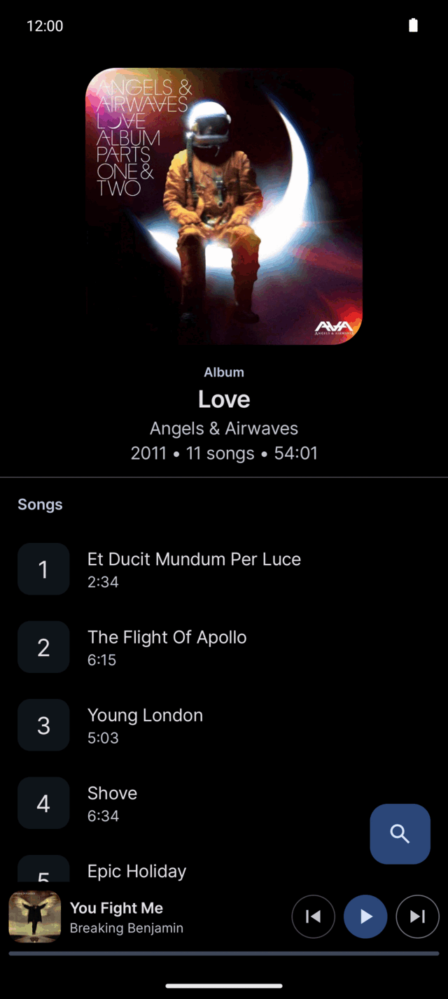
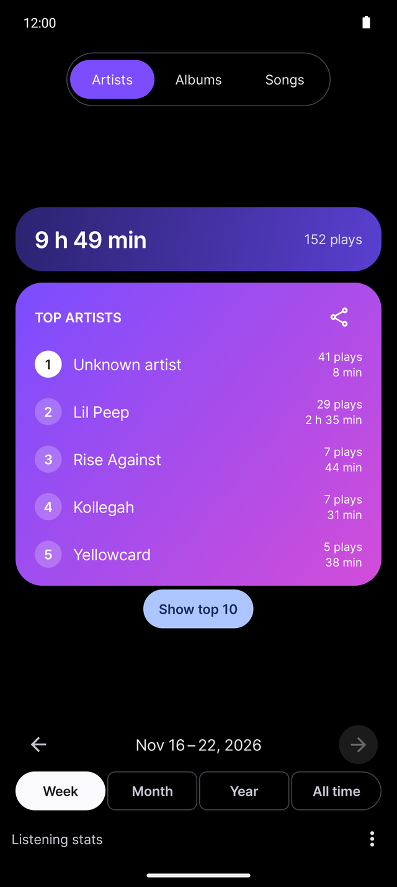
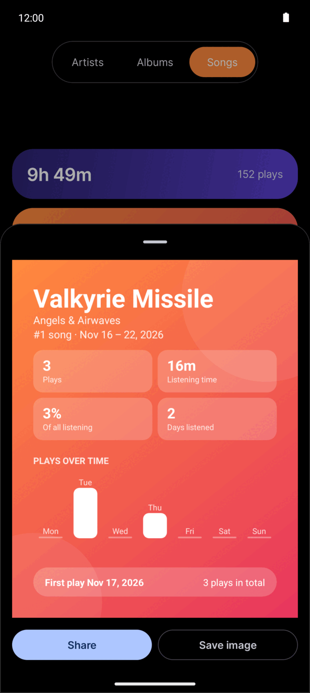
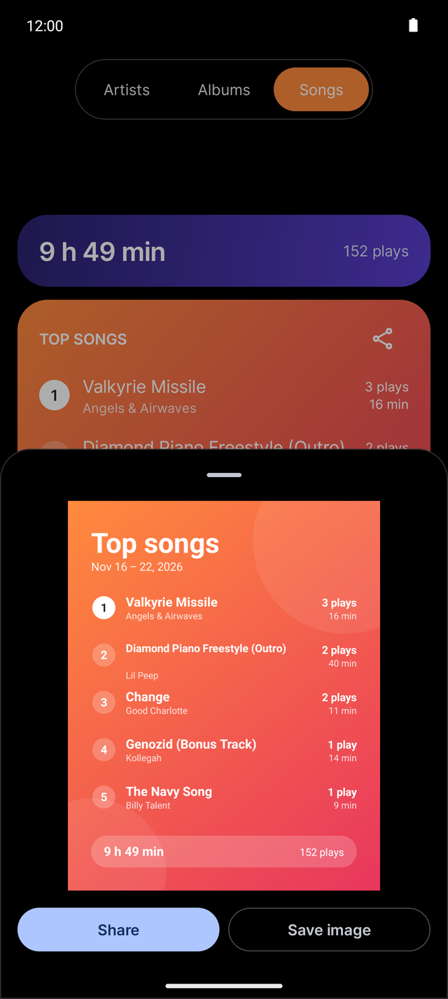
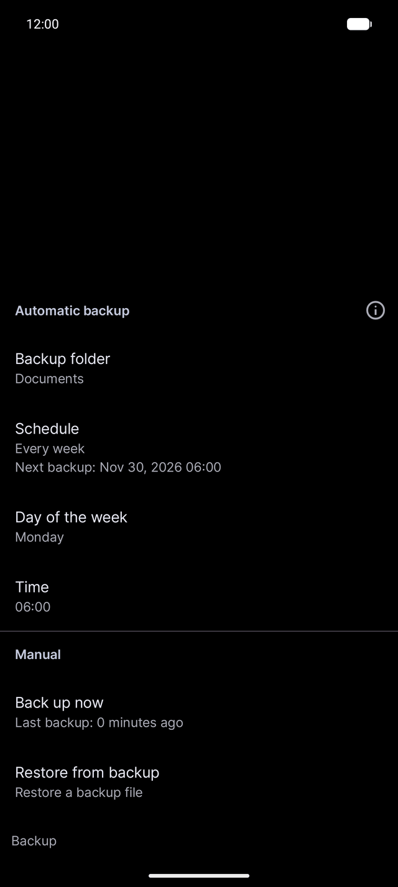
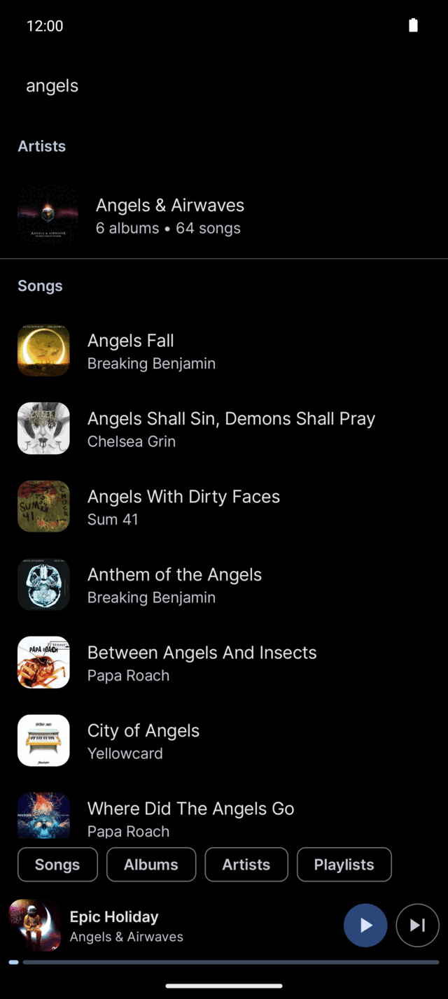

<p align="center"></p>
<h1 align="center"><b>Noxio</b></h1>
<h4 align="center">A simple, rational music player for Android, built for listening through the night.</h4>
<p align="center">
    <a href="https://github.com/Velcorn/Noxio/actions/workflows/ci.yml"></a>
    <a href="#tests"></a>
    <a href="https://github.com/Velcorn/Noxio/releases"></a>
    
    
    
</p>
<p align="center"><b><a href="CHANGELOG.md">Changelog</a></b> · <a href="docs/GESTURES.md">Gestures</a> · <a href="ROADMAP.md">Roadmap</a> · <a href="https://github.com/Velcorn/Noxio/releases">Releases</a></p>

> [!WARNING]
> **I'm not an Android developer.** Noxio is a personal project, written almost entirely with an AI assistant for my
> own use. The logic has unit tests; the screens are only checked by hand, on an emulator and my own phone. It is
> shared as is, with no promise of support.

## About

Noxio is a fork of [Auxio](https://github.com/OxygenCobalt/Auxio) by Alexander Capehart, a fast and reliable local
music player. The name merges **Auxio** with **Nocturne**: it started because a player to fall asleep to needs a sleep
timer. Noxio is **not** affiliated with the Auxio project, so please don't report its issues upstream.

**Noxio only changes your files when you ask it to:** when you edit a song's tags, after Android has asked for permission. What it works out, like listening stats, stays in its own database or in files you export.

## What's different from Auxio

Two of the additions are features Auxio
[has decided not to add](https://github.com/OxygenCobalt/Auxio/wiki/Why-Are-These-Features-Missing%3F): a **sleep
timer** and **tag editing**.

- **Sleep timer:** hold play/pause. Three editable durations, shortest first; finish the last song, fade out, shake to restart.
  The countdown shows in the play button and in a quiet notification with +10 min, Restart and Stop; it pauses with playback.
- **Listening stats:** top artists, albums and songs per week, month, year or all time, picked by week number, month or year,
  a closer look at each, and cards to share or save, opened from Settings. A named **year in review** with a listening heatmap and monthly listening time.
- **Tag editing:** deliberately basic, for quick fixes on the phone: title, artists, album, album artists, track and
  date of one song at a time, from Song properties. Playlists follow the song when an edit changes its identity. For
  bigger jobs (many files, covers, lookups) use a real tag editor such as Picard or kid3.
- **Backup:** settings, listening history and playlists as `Noxio_Backup_YYYY-MM-DD_HH-MM-SS.zip`, daily, weekly
  or monthly, the last five kept. A backup with much less than your biggest one is not written on its own: you get a
  warning and confirm it. Restore shows what's inside first and applies the restored theme right away.
- **Queue and playlists:** the song that played is ready right after a restart, before the library has loaded. The queue
  has its own search button (a long press shuffles, saves or clears it), opens at the song that plays, opens with a swipe up on the player, and can be cleared or saved
  as a playlist. Playlists can be searched, sorted and have songs taken out,
  with no song added twice and duplicates removed in one go.
- **Keyboard phones:** with a hardware keyboard (automatic, or on/off in Appearance) the screen loses its buttons,
  rows and tabs: type to search, Space plays, Ctrl plus a letter does the rest (Ctrl+H lists them). Without
  a keyboard the search row stays, so it can always be switched off.
- **One-handed layout:** icon-only tabs at the bottom with Settings as the last tab, the playing strip above
  them and a floating search button; no back or three-dot buttons, long presses and gestures instead (all in
  [docs/GESTURES.md](docs/GESTURES.md)).
- **Faster loading:** the library loads about 2.5 to 3 times faster than in Auxio (the name preparation was the
  bottleneck), with the same result.
- **Musicolet import:** weekly and monthly "Most played songs" files land in their week or month. Their days are only
  estimated, so they count for totals and weeks, not for days listened (marked with ≈ where it matters).
- **Artist visibility:** Library settings can hide song-only artists or secondary album artists, crediting albums and songs to the first album artist.
- **Short and square screens:** a compact player, totals in the stats title row and a lower album
  header, so more fits on screens like the Clicks Communicator.
- **Changelog:** every Noxio release can be read in the app, under About (bundled, so it works offline).
- **Credits:** About > Licenses lists Noxio, what it is built on and every library it ships, with the full license texts (bundled).
- **Look:** pure black theme, rounded UI, a wavy seek bar (can be turned off), and a minimal white outline icon next to the default
  one. Neither icon has a background layer, so shape-cutting launchers like Kvaesitso leave them whole.
- **Explained settings:** an "i" in the header of the less obvious groups (ReplayGain, keyboard, library, backup)
  opens a short explanation.
- **Shorter settings:** four screens (Appearance, Library, Playback, Backup), with little-used options removed;
  short lists and page titles at the bottom, fixed appearance defaults, hidden files excluded and manual refresh.
- **Detail pages:** album and artist artwork and lists start at the top, the header is centered; long titles move
  to reveal the full name. An artist's picture can be one of their album covers (A to Z) instead of the collage.
- **Languages:** English and German cover everything; Auxio's other translations stay, with Noxio's texts in English.
- **Package** `de.devfin.noxio`, so it installs next to Auxio. Releases come as a universal and a smaller ARM64 APK.

## Removed from Auxio

Noxio is built for one person's use, so it does one thing one way where Auxio offers a choice:

- **Settings with one sensible answer** are fixed instead of switchable: rounded UI, natural cover proportions,
  balanced artwork quality, no ReplayGain pre-amp, hidden files excluded, what plays when you tap a song, headset
  autoplay, pause on repeat, remembering pause, exit on close, intelligent sorting, the playback bar action and the
  sort of the home lists and an artist's songs (always by name; an artist's albums by name or date, an album by
  track or name, a playlist by name).
  Fewer switches means a settings screen you can read at a glance.
- **Automatic reloading** is off; Refresh and Rescan in Library settings load changes when you want them.
- **Multi-value separators** for all tags became one artist separator, which tag editing uses too.
- **Back and three-dot buttons** are gone for one-handed use: gestures go back, a long press opens a row's menu.
- **Genres** are left out: there is no Genres tab, and Song properties do not show them.

Everything else comes from Auxio: Media3 playback, gapless, ReplayGain from tags, rich tag support, playlists, Android Auto,
widgets, completely private and offline. Progress and what still needs a check on a phone are in
[ROADMAP.md](/ROADMAP.md).

## Screenshots

Black theme on a Pixel 9 sized emulator, with a made up library and listening history.

<table>
<tr><td align="center" width="20%"><br><sub>Sleep timer</sub></td><td align="center" width="20%"><br><sub>Now playing</sub></td><td align="center" width="20%"><br><sub>Home</sub></td><td align="center" width="20%"><br><sub>Queue</sub></td><td align="center" width="20%"><br><sub>Album</sub></td></tr>
<tr><td align="center" width="20%"><br><sub>Stats</sub></td><td align="center" width="20%"><br><sub>Artist stats</sub></td><td align="center" width="20%"><br><sub>Share card</sub></td><td align="center" width="20%"><br><sub>Backup</sub></td><td align="center" width="20%"><br><sub>Search</sub></td></tr>
</table>

## Building

Linux, macOS or WSL (not Windows) with JDK 21, NDK `28.2.13676358`, `cmake` and `ninja-build`. Clone with
`--recurse-submodules` (or run `git submodule update --init --recursive`), then:

```bash
./gradlew assembleDebug   # build
./gradlew installDebug    # install on a connected device or emulator
./gradlew app:assembleDebug -Pandroid.injected.build.abi=arm64-v8a   # faster, one architecture only
```

The code stays in the `org.oxycblt.auxio` package on purpose, so upstream changes merge with few conflicts.

## Tests

The logic Noxio adds has JVM unit tests (no device needed); `musikr` has its own. CI runs formatting, Android lint and
the tests on every push.

```bash
./gradlew coverageReport spotlessCheck app:lintDebug
python3 scripts/noxio_coverage.py build/reports/jacoco/coverageReport/coverageReport.xml noxio-code.txt
```

The coverage badge counts the Noxio files listed in `noxio-code.txt` (logic, not screens that only wire views
together). The number for all code, Auxio included, is published as `coverage-all.json`.

## Credits & License

Built on [Auxio](https://github.com/OxygenCobalt/Auxio) © Auxio Project and its dependencies, including Media3, taglib
and Material Components. Thanks to Alexander Capehart and all Auxio contributors.

Free Software under the [GNU General Public License v3.0](https://www.gnu.org/licenses/gpl-3.0.html) or later, like
Auxio. See [LICENSE](/LICENSE).
