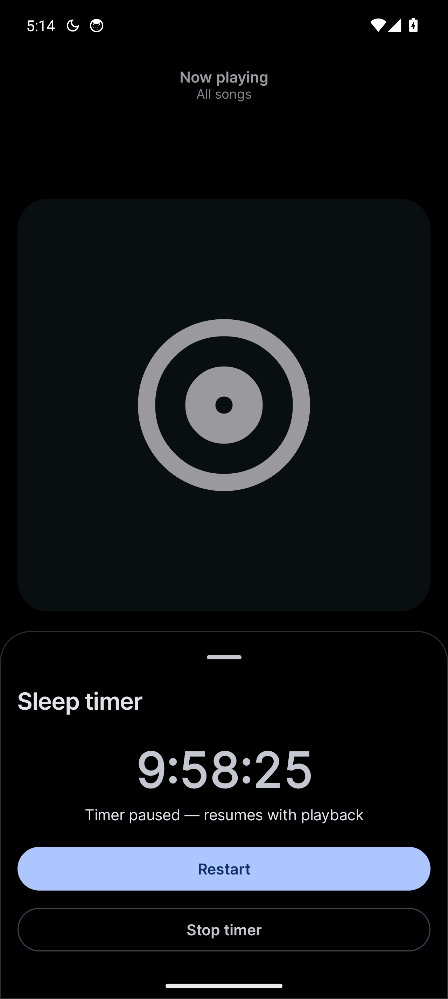
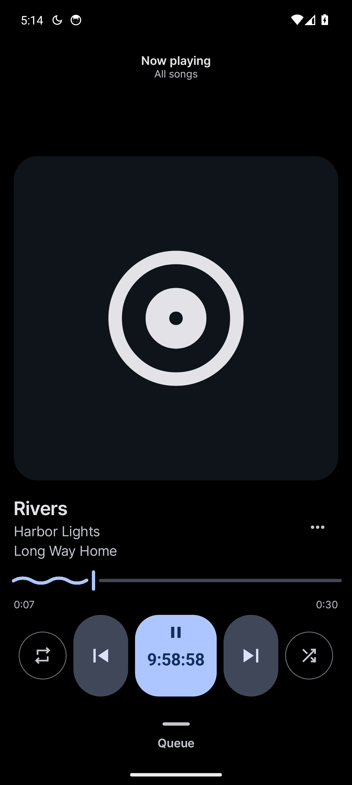
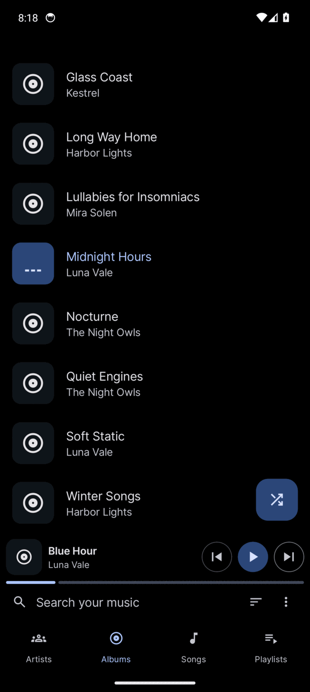
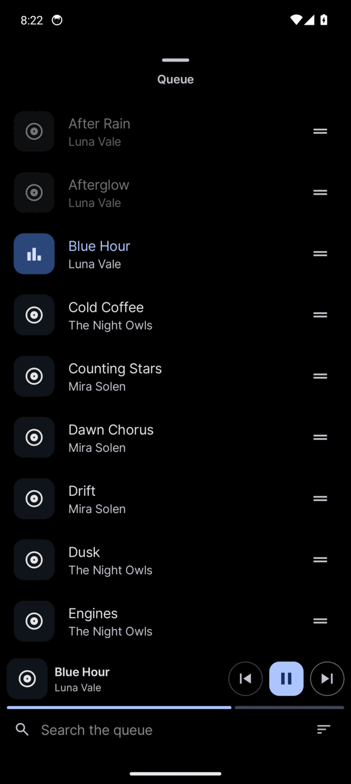
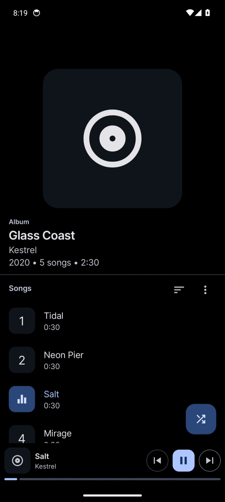
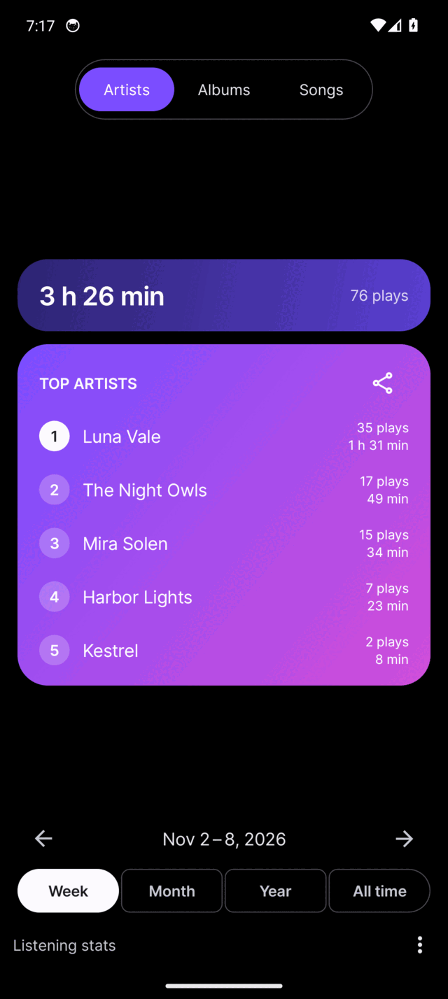
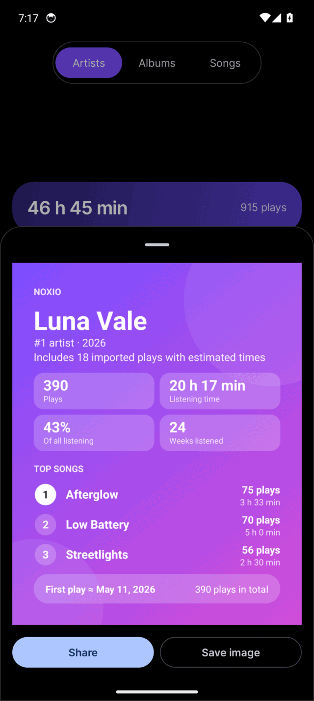
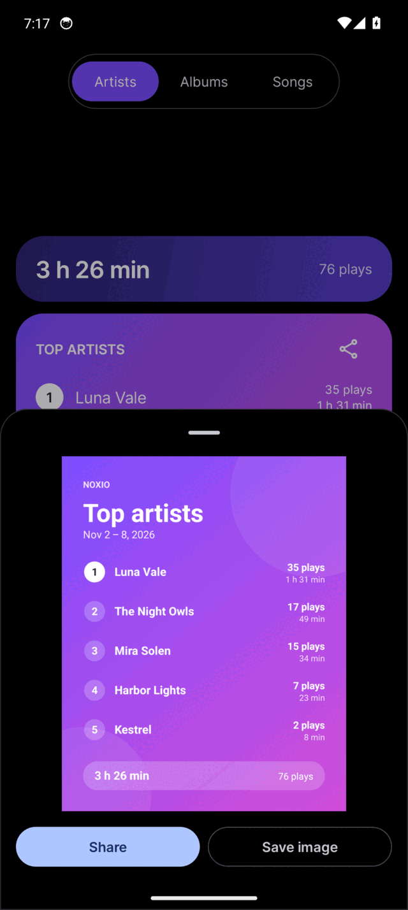
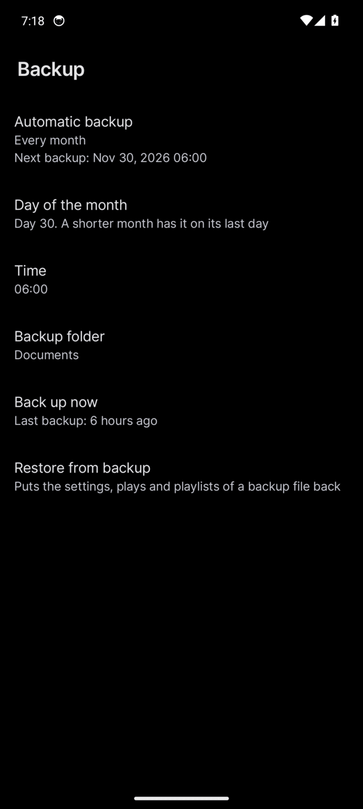
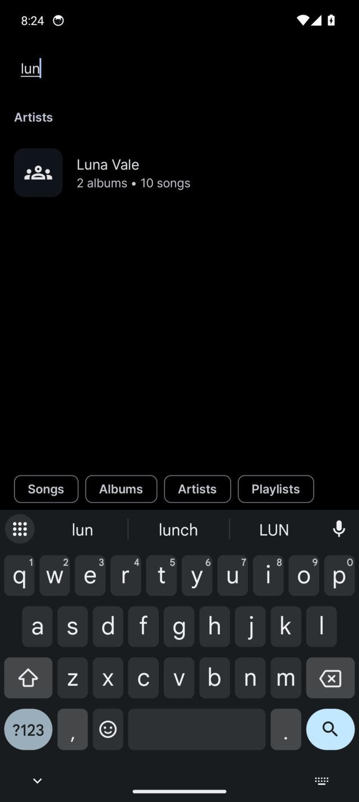

<p align="center"></p>
<h1 align="center"><b>Noxio</b></h1>
<h4 align="center">A simple, rational music player for Android, built for listening through the night.</h4>
<p align="center">
    <a href="https://github.com/Velcorn/Noxio/actions/workflows/ci.yml"></a>
    <a href="#tests"></a>
    <a href="https://github.com/Velcorn/Noxio/releases"></a>
    
    
    
</p>

> [!WARNING]
> **I'm not an Android developer.** Noxio is a personal project, written almost entirely with an AI assistant for my
> own use. The logic has unit tests; the screens are only checked by hand, on an emulator and my own phone. It is
> shared as is, with no promise of support.

## About

Noxio is a fork of [Auxio](https://github.com/OxygenCobalt/Auxio) by Alexander Capehart, a fast and reliable local
music player. The name merges **Auxio** with **Nocturne**: it started because a player to fall asleep to needs a sleep
timer. Noxio is **not** affiliated with the Auxio project, so please don't report its issues upstream.

**Noxio only reads your files.** It never edits tags or writes to your music. What it works out, like listening
stats, stays in its own database or in files you export.

## What's different from Auxio

- **Sleep timer:** hold play/pause. Three editable durations, shortest first; finish the last song, fade out, shake to restart.
  The countdown shows in the play button and in a quiet notification with +10 min, Restart and Stop; it pauses with playback.
- **Listening stats:** top artists, albums and songs per week, month, year or all time, a closer look at each, and
  cards to share or save. A **year in review** with five cards to swipe through.
- **One-handed layout:** search, sort and tabs at the bottom, the playing strip right under the search row, a
  floating shuffle button, no back buttons (gestures only), no three-dot buttons on rows (long press for the menu),
  shorter item menus.
- **Backup:** settings, listening history and playlists as `noxio_YYYY-MM-DD.zip`, daily, weekly or monthly, the last
  five kept. A much smaller backup never replaces a good one. Restore shows what's inside first.
- **Musicolet import:** weekly and monthly "Most played songs" files land in their week or month. Their days are only
  estimated, so they count for totals and weeks, not for days listened (marked with ≈ where it matters).
- **Queue** with search and sort, opening at the song that plays, opened by swiping up on the player, and saving as a playlist; **playlists** you can
  search, sort and take songs out of, with no song added twice and duplicates removed in one go.
- **Keyboard phones:** with a hardware keyboard (automatic, or on/off in Appearance) the screen loses its buttons,
  rows and tabs: type to search, Space plays, Ctrl plus a letter does the rest (Ctrl+H lists them). Without
  a keyboard the search row stays, so it can always be switched off.
- **Short and square screens:** a compact player, icon-only tabs, totals in the stats title row and a lower album
  header, so more fits on screens like the Clicks Communicator.
- **Look:** pure black theme, rounded UI, a wavy seek bar, and a minimal white outline icon next to the default
  one. Neither icon has a background layer, so shape-cutting launchers like Kvaesitso leave them whole.
- **Shorter settings:** four screens (Appearance, Playback, Library, Backup), with little-used options removed;
  short lists and page titles at the bottom, fixed appearance defaults, hidden files excluded and manual refresh.
- **Languages:** English and German cover everything; Auxio's other translations stay, with Noxio's texts in English.
- **Package** `de.devfin.noxio`, so it installs next to Auxio. Releases come as a universal and a smaller ARM64 APK.

Everything else comes from Auxio: Media3 playback, gapless, ReplayGain, rich tag support, playlists, Android Auto,
widgets, completely private and offline. Progress and what still needs a check on a phone are in
[ROADMAP.md](/ROADMAP.md).

## Screenshots

Black theme on a Pixel 9 sized emulator, with a made up library and listening history.

<table>
<tr><td align="center" width="20%"><br><sub>Sleep timer</sub></td><td align="center" width="20%"><br><sub>Now playing</sub></td><td align="center" width="20%"><br><sub>Home</sub></td><td align="center" width="20%"><br><sub>Queue</sub></td><td align="center" width="20%"><br><sub>Album</sub></td></tr>
<tr><td align="center" width="20%"><br><sub>Stats</sub></td><td align="center" width="20%"><br><sub>Artist stats</sub></td><td align="center" width="20%"><br><sub>Share card</sub></td><td align="center" width="20%"><br><sub>Backup</sub></td><td align="center" width="20%"><br><sub>Search</sub></td></tr>
</table>

## Building

Linux, macOS or WSL (not Windows) with JDK 21, NDK `28.2.13676358`, `cmake` and `ninja-build`. Clone with
`--recurse-submodules` (or run `git submodule update --init --recursive`), then:

```bash
./gradlew assembleDebug   # build
./gradlew installDebug    # install on a connected device or emulator
./gradlew app:assembleDebug -Pandroid.injected.build.abi=arm64-v8a   # faster, one architecture only
```

The code stays in the `org.oxycblt.auxio` package on purpose, so upstream changes merge with few conflicts.

## Tests

The logic Noxio adds has JVM unit tests (no device needed); `musikr` has its own. CI runs formatting, Android lint and
the tests on every push.

```bash
./gradlew coverageReport spotlessCheck app:lintDebug
python3 scripts/noxio_coverage.py build/reports/jacoco/coverageReport/coverageReport.xml noxio-code.txt
```

The coverage badge counts the Noxio files listed in `noxio-code.txt` (logic, not screens that only wire views
together). The number for all code, Auxio included, is published as `coverage-all.json`.

## Credits & License

Built on [Auxio](https://github.com/OxygenCobalt/Auxio) © Auxio Project and its dependencies, including Media3, taglib
and Material Components. Thanks to Alexander Capehart and all Auxio contributors.

Free Software under the [GNU General Public License v3.0](https://www.gnu.org/licenses/gpl-3.0.html) or later, like
Auxio. See [LICENSE](/LICENSE).
