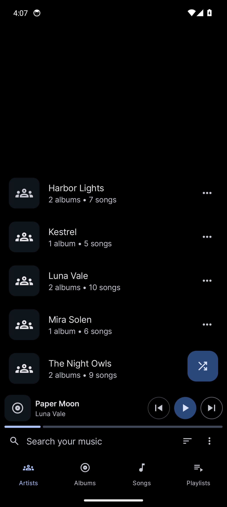
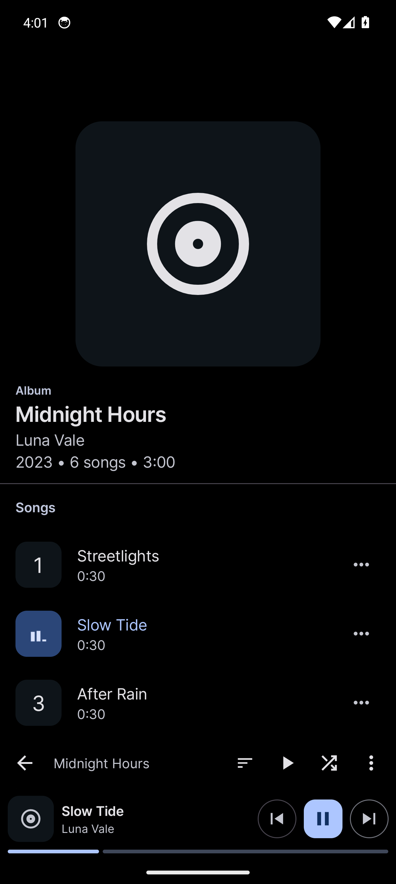
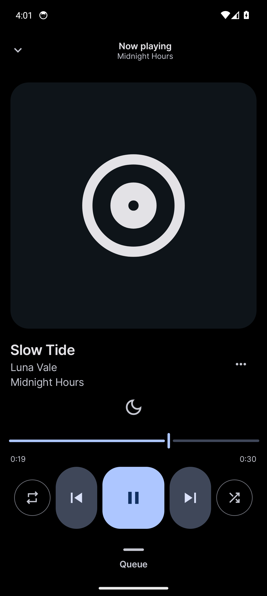
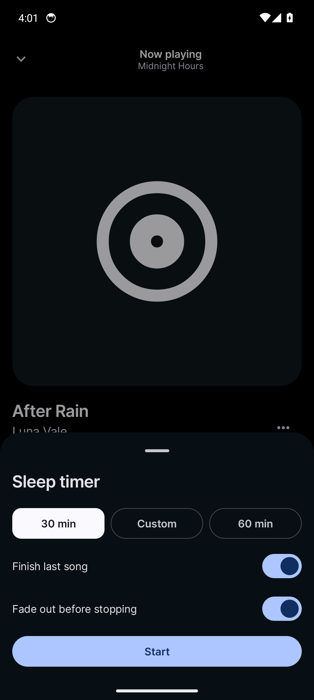
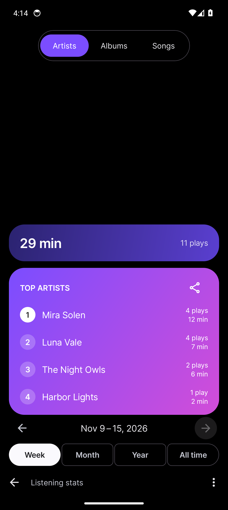
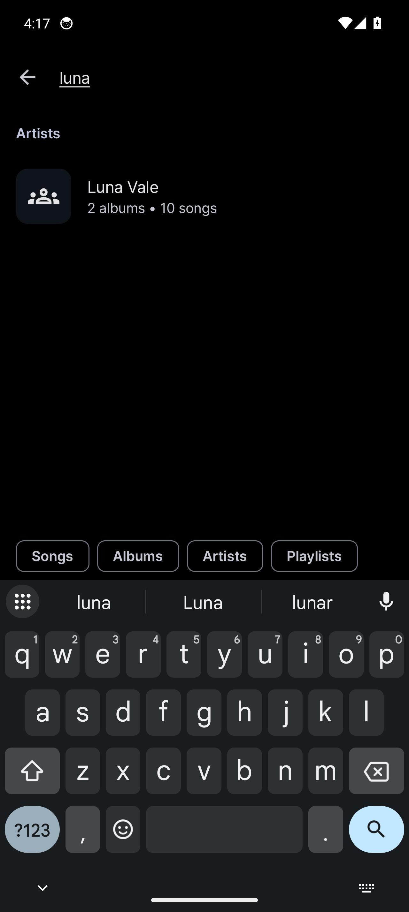

<p align="center"></p>
<h1 align="center"><b>Noxio</b></h1>
<h4 align="center">A simple, rational music player for Android, built for listening through the night.</h4>
<p align="center">
    <a href="https://github.com/Velcorn/Noxio/actions/workflows/ci.yml"></a>
    <a href="#tests"></a>
    <a href="#tests"></a>
    <a href="https://github.com/Velcorn/Noxio/releases"></a>
    
    
    
</p>

> [!WARNING]
> **I'm not an Android developer.** Noxio is a personal project, and most of its changes are vibe-coded with
> an AI assistant for my own use. Expect rough edges, and review anything you rely on.
>
> The main reason this fork exists is the **sleep timer**. **Listening stats** (a barebones, Spotify
> Wrapped-style summary) are a nice to have. Anything else is a small tweak I wanted for myself.
> It is shared as is, with no promise of support or stability.

## About

Noxio is a fork of [Auxio](https://github.com/OxygenCobalt/Auxio) by Alexander Capehart. Auxio is a great local music
player with a fast, reliable UI, and Noxio keeps that foundation. The name merges **Auxio** with **Nocturne**: the fork
started because a music player that is good to fall asleep to needs a sleep timer.

Noxio is a personal project and will keep diverging from upstream. It is **not** affiliated with the Auxio project, and
upstream issues should not be reported against it.

## What's different from Auxio

| | Auxio | Noxio |
| --- | --- | --- |
| Sleep timer | none | Moon icon above the seek bar. End of track, 30 min, custom minutes or 60 min, with fade-out. Remembers your last choice. Restart it from the notification or by shaking the device. |
| Listening stats | none | Home menu > Listening stats. Top artists, albums and songs with plays and time listened for each, plus the total, per week, month, year or all time. The artists, albums and songs switch is at the top and you can also swipe between them, while the range and period controls are at the bottom, in reach of the thumb. Colorful cards you can share as an image, CSV export and import with an optional weekly backup to a folder (one file that is replaced each time, with a "Back up now" button). Musicolet's "Most played songs" lists import as your history from before Noxio, counted in All time only. Stored on the device only. |
| Now playing layout | Controls in the middle of the screen | Content packed towards the bottom for one-handed use, and the playing strip moves to the bottom while the queue is open. Optional wavy seek bar (Settings > Appearance), off by default |
| Navigation | Tabs and search at the top, five tabs including Genres | Search row and tabs at the bottom of the home screen (Artists, Albums, Songs, Playlists, no Genres tab), the player above the navigation, a floating shuffle button. Short lists sit at the bottom edge instead of the top |
| Detail pages | Header with Play and Shuffle pills, sort in the list header | Album, genre, playlist and artist pages have a bottom bar (back, name, sort, play, shuffle, more). Artist pages have Albums and Songs tabs you can swipe between, each with its own sort, and the search filters the list shown. Playlists can be searched, sorted and kept in a custom order |
| Search | Filter chips at the top, every type is searched | Filter chips at the bottom, above the keyboard. Only the types that have a tab on the home screen are shown and searched |
| List rows | A button with three dots on every row, long press selects | No dots on the rows, a long press opens the menu of the item |
| Black theme | Black background, tinted menus | Popup menus, dialogs, bottom sheets (including the sleep timer and item menus), the app bar and the status bar stay pure black. Shuffle and repeat in the notification are grey when off |
| Settings | One long list with Personalize and UI | Five screens by purpose: Appearance, Home and player, Playback, Library and Listening stats |
| App icon | One icon | Default (crescent and sparkle on black), or a minimal white silhouette with no background, chosen in Settings > Appearance |
| Equalizer shortcut | Button in the now playing toolbar | Moved to Settings > Playback |
| About | Auxio author, donate and supporters, upstream links | Noxio's own source and issue links, with the Auxio credit and a notice that Noxio is a fork and not affiliated |
| Library actions | Refresh and rescan without feedback | Rescan asks first and both show their progress and result |
| Package name | `org.oxycblt.auxio` | `de.devfin.noxio`, so it installs next to Auxio |

Everything above is built and unit tested where there is logic, but screens have no automated tests and
only some of it has been tried on a device. Progress is tracked in
[ROADMAP.md](/ROADMAP.md). Everything else is inherited from Auxio: Media3 playback, gapless playback, ReplayGain, rich
tag support (multiple artists, release types, disc numbers, sort tags), playlists, playback persistence, Android Auto,
widgets, and being completely private and offline.

**Noxio only reads your files.** It never edits tags or writes to your audio files, and editing tags is not part
of the project. Anything it works out, such as listening stats, stays in its own database or in files you export.

## Screenshots

Black theme on a Pixel 9 sized emulator, with a made up library and listening history.

<table>
<tr><td align="center"><br><sub>Artists</sub></td><td align="center"><br><sub>Album</sub></td><td align="center"><br><sub>Now playing</sub></td></tr>
<tr><td align="center"><br><sub>Sleep timer</sub></td><td align="center"><br><sub>Listening stats</sub></td><td align="center"><br><sub>Search</sub></td></tr>
</table>

Also in [docs/screenshots](docs/screenshots): the albums list, an artist page and the About page.

## Minimal icon

Besides the default icon, Noxio has a minimal version: the crescent, the play button and a star as thin white
outlines with no background at all, drawn like the icons of [Arcticons](https://github.com/Donnnno/Arcticons) so it
sits straight on your wallpaper and does not stand out in a launcher that uses that pack. Switch to it in Settings >
Appearance > App icon. Any launcher shows the choice, since it is the app's own launcher icon, and launchers that
support themed icons (like Kvaesitso) tint the single-color layer with your theme colors.

## Branches

- `main`: stable, releasable state
- `dev`: day-to-day development; merged into `main` when ready

## Permissions

- Storage (`READ_MEDIA_AUDIO`, `READ_EXTERNAL_STORAGE`) to read and play your music files
- Services (`FOREGROUND_SERVICE`, `WAKE_LOCK`) to keep the music playing in the background
- Notifications (`POST_NOTIFICATION`) to indicate ongoing playback and music loading

## Building

Noxio relies on a patched Media3 and taglib, which adds some caveats:

1. `cmake` and `ninja-build` must be installed.
2. The project uses submodules: clone with `git clone --recurse-submodules`, or run
   `git submodule update --init --recursive` afterwards.
3. Building on Windows is not supported (the Media3 build runs unix shell scripts). Use Linux, macOS or WSL.
4. You need JDK 21 and NDK `28.2.13676358` (installable through Android Studio's SDK manager).

```bash
./gradlew assembleDebug   # build
./gradlew installDebug    # install on a connected device or emulator
```

The code still lives under the `org.oxycblt.auxio` package on purpose, so changes from upstream can be merged with
minimal conflicts. Only the application ID and branding differ.

## Tests

The code Noxio adds has unit tests that run on the JVM, with no device or emulator: the formatting and navigation of the stats screen, the backup folder handling, how a search matches names, the settings of the search, the launcher icon switch, the share image, the swipe and bottom alignment maths, the listening stats (play
counting including repeated songs, CSV export and import, ranking, the weekly, monthly, yearly and all time ranges,
the undated "before Noxio" plays, the safe weekly backup) and the sleep timer (state, fade, shake detection). The
music library (`musikr`) comes with its own tests. They run in WSL, Linux or macOS like the build:

```bash
./gradlew coverageReport            # runs the tests of the app and musikr, writes the all-code coverage report
python3 scripts/noxio_coverage.py build/reports/jacoco/coverageReport/coverageReport.xml noxio-code.txt   # the Noxio code number and its gaps
./gradlew spotlessCheck app:lintDebug
```

The coverage report is in `build/reports/jacoco/coverageReport/index.html`.

**There are two coverage badges.** "Noxio code" counts the files Noxio added that can reasonably be unit tested, which
are listed in `noxio-code.txt`: the logic, helpers and views with behavior. Screens and dialogs that only wire views
together are left out of it on purpose, and so is dependency injection. "All code" counts everything, Auxio and the
music library included, and leaves out only generated code (view binding, Hilt, Room, resources); it is low on purpose,
as most of that code has no tests. Everything visible, the screens included, still needs a look on a device.

GitHub Actions runs the formatting check, Android lint and the tests on every push and pull request, and refreshes
the badge from `dev`. Android lint knows the problems that came with Auxio (`app/lint-baseline.xml`), so only new
ones fail the build.

## Credits & License

Noxio is built on [Auxio](https://github.com/OxygenCobalt/Auxio) © Auxio Project, and on its dependencies, including
Media3, taglib and Material Components. Thanks to Alexander Capehart and all Auxio contributors.

Noxio is Free Software, licensed under the
[GNU General Public License v3.0](https://www.gnu.org/licenses/gpl-3.0.html) or later, the same as Auxio. See
[LICENSE](/LICENSE).
